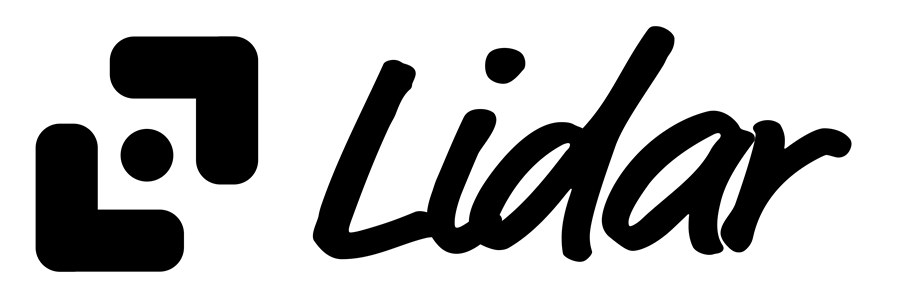

<p align="center">
  
</p>

# LiDAR

Windows x64용 SteamVR 스캐너입니다. [최신 Release](https://github.com/sinonmiyaki/LiDAR/releases/latest)에서 `LiDAR-Setup-…-x64.exe`를 받아 설치하고 시작 메뉴에서 **LiDAR**를 실행하세요. LiDAR를 먼저 열어도 SteamVR과 헤드셋이 준비되면 자동으로 연결됩니다. 기본 손가락 바인딩은 Valve Index 컨트롤러용입니다.

1. SteamVR에서 VRChat을 실행하고 대시보드를 닫습니다. 월드나 UI의 QR 또는 텍스트를 찾습니다.
2. 양쪽 엄지와 검지를 펴서 L자 모양을 만들고, 나머지 손가락으로 그립을 잡습니다. 두 손을 얼굴 앞에 두면 반투명 사각형이 나타납니다. 손의 실제 3D 위치에 따라 창이 좌우와 앞뒤로 움직이고, 두 손의 간격과 깊이 차에 따라 크기와 기울기가 바뀝니다.
3. 사각형이 밝아지면 원하는 내용을 창 가운데에 맞추고 L자 자세를 풉니다. QR을 찾으면 캡처를 잠깐 보여준 뒤, 링크가 있는 경우 VRChat 화면을 유지한 채 PC의 기본 브라우저에서 엽니다.
4. QR이 없는 영역은 RapidOCR이 읽고 원문 언어를 자동 감지합니다. 번역을 VR 결과 카드에 표시하고, 앱의 **AI 번역** 화면에 원문과 결과를 남깁니다.

왼손·오른손·위치 체크는 앱 창에서 확인할 수 있습니다. 앱을 닫으면 스캔이 종료됩니다.

**설정 → 번역 언어** 또는 대시보드의 **AI 번역** 카드 옆 톱니에서 결과 언어를 변경할 수 있습니다. 기본값은 한국어이며 선택은 다음 실행에도 적용됩니다.

최근 스캔이 웹 링크 QR이면 **최근 스캔** 카드에서 주소를 눌러 다시 열 수 있습니다.

OCR은 설치 프로그램에 포함된 [RapidOCR](https://github.com/RapidAI/RapidOCR)과 PP-OCR 모델을 사용해 PC에서 실행합니다. 대시보드에서 **QR 스캔**과 **AI 번역**을 각각 켜고 끌 수 있습니다. **설정 → 번역 모델 설정**에서 아래 모델을 고릅니다.

- **GPT-6 Luna**는 ChatGPT 연결 후 추론 `none`으로 요청합니다. Codex가 해당 설정을 거절하고 `low`를 제공하면 `low`로 전환합니다. 번역은 로그인한 계정의 Codex 사용 한도에 포함됩니다. [Codex 사용 한도](https://learn.chatgpt.com/docs/pricing)
- **DeepL**은 사용자별 API 키가 필요합니다. 신규 Developer 플랜은 총 100만 자를 체험할 수 있고 한도는 초기화되지 않습니다. Developer 키는 개인정보가 없는 텍스트에만 사용하세요. [요금제](https://support.deepl.com/hc/en-us/articles/360021200939-DeepL-API-plans) · [이용 약관](https://www.deepl.com/en/pro-license_embedded)
- **Local (M2M-100 418M INT8)**은 모델을 처음 한 번 다운로드한 뒤 오프라인으로 번역합니다. 기존 버전에서 모델이 설치되어 있으면 재사용합니다. VRChat과 동시에 실행하면 CPU와 메모리 사용량이 늘 수 있습니다.

클라우드 모델에는 OCR로 읽은 텍스트를 보냅니다. 번역 요청이 실패하면 VR에 원문을 표시합니다. API 키는 Windows 사용자 계정으로 암호화해 저장합니다.

**설정 → SteamVR 기동 시 자동 실행**을 켜면 실행 중인 SteamVR에 LiDAR를 등록합니다. SteamVR이 꺼져 있을 때 바꾼 설정은 다음에 두 프로그램이 함께 실행될 때 적용됩니다.

LiDAR를 열 때 새 GitHub Release를 확인합니다. **지금 업데이트**는 설치 파일을 다운로드하고 검증한 뒤 설치 프로그램을 엽니다. **이번 버전 건너뛰기**는 해당 버전에 대한 알림을 숨기고, **나중에**를 누르면 다음 실행 때 다시 확인합니다.

**AI 어시스턴트**는 준비 중입니다.

PC 화면과 VR 결과 카드에 [Pretendard](https://github.com/orioncactus/pretendard)를 사용합니다. 번들 구성 요소의 배포 고지는 [THIRD_PARTY.md](THIRD_PARTY.md)에 있습니다.

[카메라 세리머니 참고](https://www.tottenhamhotspur.com/news/988624/sonny-explains-his-celebration-as-he-reaches-his-premier-league-century) · [SteamVR 손가락 추적](https://github.com/ValveSoftware/openvr/wiki/SteamVR-Skeletal-Input)

## Windows 빌드

앱 UI에서 표시하는 팝업은 `InAppDialog`를 사용해 LiDAR 메인 창 안에서 엽니다.

Python 3.10 x64와 Inno Setup 6.7을 사용합니다. `updater.py`의 `VERSION`, Inno Setup의 `AppVersion`, GitHub 릴리스 태그 `vX.Y.Z`를 일치시킵니다.

```powershell
python -m venv .venv
.\.venv\Scripts\python -m pip install -r requirements.txt pyinstaller==6.20.0
.\.venv\Scripts\python fetch_models.py
.\.venv\Scripts\python -m PyInstaller --noconfirm LiDAR.spec
ISCC.exe /DAppVersion=0.2.3 installer.iss
```

Inno Setup의 `Output` 폴더에 생성된 설치 파일을 같은 버전의 GitHub Release에 첨부합니다.
